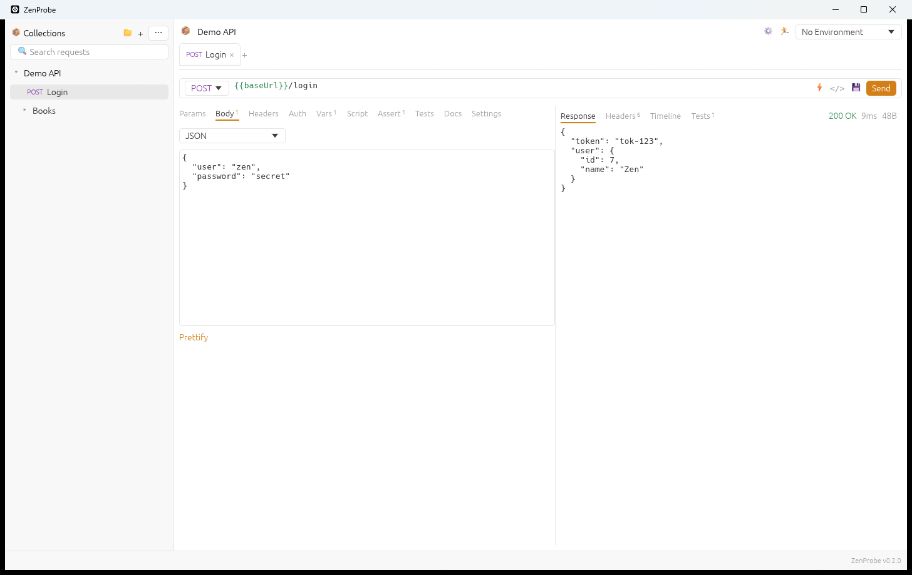
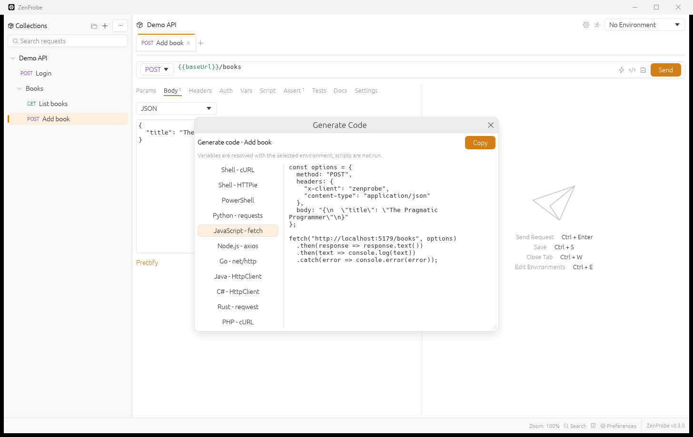
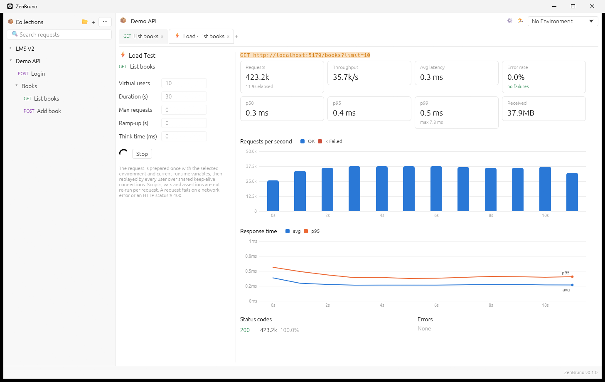

# ZenBruno

**A fast, native API client for [Bruno](https://www.usebruno.com/) collections — written in Rust.**

ZenBruno opens your existing Bruno collections (both the classic `.bru` format and the newer
OpenCollection YAML format) and lets you send, script, test and load-test requests from a
lightweight desktop app with a Bruno-style interface. No Electron, no Node.js — a single
native executable.



> ZenBruno is an independent project and is not affiliated with Bruno. See
> [THIRD_PARTY_NOTICES.md](THIRD_PARTY_NOTICES.md).

## Features

**Collections & files**
- Opens Bruno collections in **`.bru`** (`bruno.json`) and **OpenCollection YAML** (`opencollection.yml`) formats
- Saves files byte-for-byte in Bruno's own format — no noisy diffs, unknown blocks/keys preserved
- Folders, collection & folder settings (headers, vars, auth, scripts, tests, docs)
- Create, rename, clone and delete requests and folders
- Environments (create, edit, delete), secret variables (kept in memory only), `.env` / `process.env`

**Requests**
- HTTP: all methods, query/path params, headers, JSON / XML / text / SPARQL / form-urlencoded /
  multipart (with file uploads) / binary file bodies
- GraphQL (query + variables)
- gRPC: load methods from a `.proto` file or **server reflection**; unary, server-, client- and
  bidirectional streaming; sample-message generation
- WebSocket: connect with headers, send messages, live message log
- Auth: inherit (folder → collection), none, basic, bearer
- `{{variable}}` interpolation with Bruno's precedence (collection < environment < folder <
  request < runtime), `{{$timestamp}}`, `{{$randomUUID}}`, `{{$randomInt}}`
- Per-request settings: timeout, redirects, URL encoding; shared cookie jar

**Scripting & testing** (embedded JavaScript engine)
- Pre-request and post-response scripts at collection, folder and request level (Bruno's order)
- Bruno's script API: `bru.setVar/getVar/setEnvVar/getEnvVar/interpolate/sleep/setNextRequest/runner.*`,
  `req.*`, `res.*`, `res('path')`, `console.*`
- `test()` with a chai-style `expect` (`to.equal`, `eql`, `have.property`, `include`, `a/an`,
  `lengthOf`, `above/below`, `match`, `status`, …) and `assert`
- Post-response vars (`res.body.token` or any JS expression) and declarative assertions
  (`eq`, `neq`, `gt`, `contains`, `isArray`, `startsWith`, …)

**Collection runner**
- Run a whole collection or a folder with delay, iterations, include/exclude tags
- Honours `bru.setNextRequest`, `bru.runner.skipRequest` and `stopExecution`
- Pass / fail / skip summary with per-request details

**cURL**
- **Import**: paste a cURL command into the URL bar, or *Import cURL* from a folder's menu
  (bash and Windows cmd "Copy as cURL" supported)
- **Export**: *Generate code* (`</>`) produces a ready-to-run cURL command with variables resolved



**Load testing**
- Virtual users, duration, request cap, ramp-up and think time
- Live throughput, error rate, avg / p50 / p95 / p99 / max latency, status codes and errors
- Requests-per-second and response-time charts; copy a text summary



## Install

Download `ZenBruno-Setup-<version>.exe` from the
[Releases](https://github.com/muhammadjunaid1982/ZenBruno/releases) page and run it.

- Installs per user to `%LOCALAPPDATA%\Programs\ZenBruno` — no administrator rights needed
- Adds Start Menu and Desktop shortcuts and an entry in *Settings → Apps*
- Silent install: `ZenBruno-Setup-<version>.exe /S`
- Uninstall from *Settings → Apps* (your collections are never touched)

The installer is not code-signed yet, so Windows SmartScreen may show *"Windows protected your
PC"* — choose **More info → Run anyway**.

## Build from source

Requirements: Windows 10/11, [Rust](https://rustup.rs/) 1.88+ and the MSVC build tools
(installed with Visual Studio Build Tools / rustup's default MSVC toolchain).

```powershell
git clone https://github.com/muhammadjunaid1982/ZenBruno.git
cd ZenBruno
cargo run --release          # run the app
cargo test --release         # run the test suite
.\build-installer.ps1        # build dist\ZenBruno-Setup-<version>.exe
```

Open a collection directly from the command line:

```powershell
zenbruno.exe "C:\path\to\collection"
zenbruno.exe "C:\path\to\collection\folder\request.yml"
```

## Keyboard shortcuts

| Action | Shortcut |
|---|---|
| Send request | `Ctrl + Enter` |
| Save | `Ctrl + S` |
| Close tab | `Ctrl + W` |
| Environments | `Ctrl + E` |

In the sidebar, click a folder's name to open its settings; click the ▸ / ▾ arrow to collapse or
expand it.

## Project layout

| Path | Purpose |
|---|---|
| `src/bru.rs` | `.bru` parser / writer |
| `src/yml.rs` | OpenCollection YAML parser / writer |
| `src/model.rs` | Format-independent request, folder and environment model |
| `src/collection.rs` | Collections on disk: tree, file operations, environments |
| `src/exec.rs` | Request pipeline (vars → scripts → interpolation → send → tests → asserts) |
| `src/script.rs` | Embedded JavaScript runtime (boa) and Bruno's script API |
| `src/interp.rs` | `{{var}}` interpolation and assertion operators |
| `src/http.rs`, `src/grpc.rs`, `src/ws.rs` | HTTP, gRPC and WebSocket clients |
| `src/curl.rs` | cURL import / export |
| `src/loadtest.rs` | Load-test engine and statistics |
| `src/app.rs`, `src/ui.rs` | Desktop UI (egui) |
| `installer/` | Self-contained Windows installer |

## Not supported (yet)

- OAuth 1/2, digest, NTLM, AWS SigV4, API-key, WSSE and Akamai auth (kept in files, not applied)
- Importing/exporting Postman/Insomnia/OpenAPI collections, Git integration, AI features
- Proxy and client-certificate settings
- `require()` of npm modules in scripts (only `chai` is available)
- Request history and code generation for languages other than cURL

## Acknowledgements

- **[REA](https://github.com/morluto/rea)** (`rea-agents`) — the reverse-engineering toolkit used to
  analyze the shipped Bruno desktop app (its Electron `app.asar` inventory and runtime behaviour) so
  ZenBruno could match Bruno's file formats, request pipeline and user interface.
- **[Bruno](https://github.com/usebruno/bruno)** — the original open-source API client whose MIT-licensed
  formats and behaviour ZenBruno reimplements.
- **[egui / eframe](https://github.com/emilk/egui)**, **[boa](https://github.com/boa-dev/boa)**,
  **[reqwest](https://github.com/seanmonstar/reqwest)**, **[tonic](https://github.com/hyperium/tonic)**,
  **[protox](https://github.com/andrewhickman/protox)** and
  **[tungstenite](https://github.com/snapview/tungstenite-rs)**, which do much of the heavy lifting.

## Contributing

Issues and pull requests are welcome. Please run `cargo test --release` before submitting.

## License

[MIT](LICENSE) © 2026 Muhammad Junaid. Portions are derived from Bruno (MIT) — see
[THIRD_PARTY_NOTICES.md](THIRD_PARTY_NOTICES.md).
